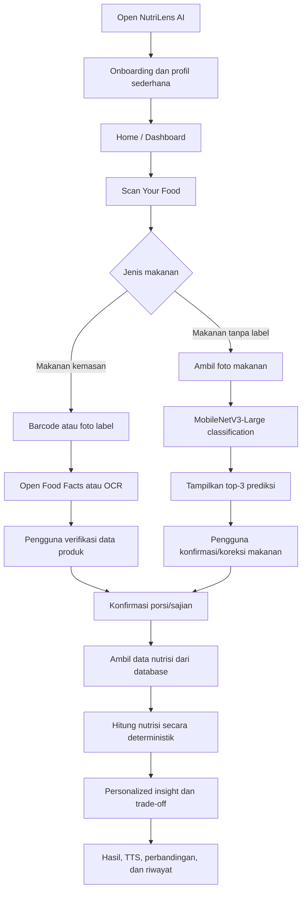
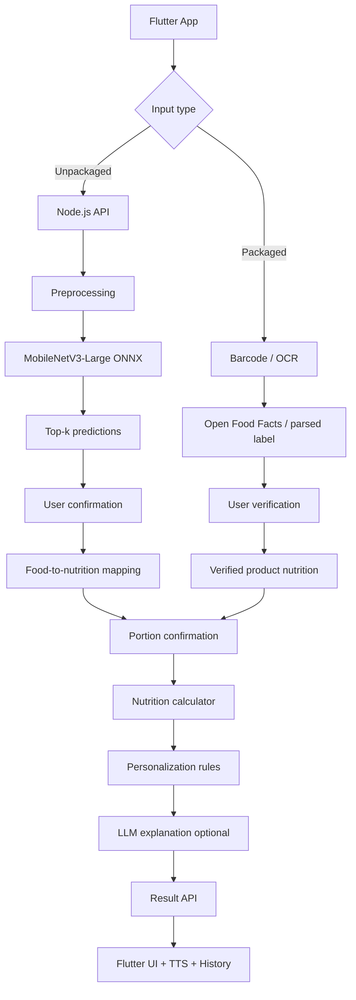

# NutriLens AI — Project Brainstorming & Product Foundation

> **Working title:** NutriLens AI (Nama Belum Fix)

> Addendum 7 November 2026: pengguna menyetujui backend scanner konsumsi pada `add-scanner-consumption-backend`. Jalur ini menggantikan rencana ONNX/verified-only historis dengan satu panggilan DeepSeek vision, estimasi/ekstraksi berprovenance, RAG SQL, jurnal otomatis dan kalkulasi quantity deterministik. Lihat [keputusan pengganti](DECISIONS.md) dan [panduan backend](../server/README.md#scanner-konsumsi-development). Implementasi diuji dengan provider mock; live DeepSeek belum diuji. Flutter tetap di luar scope change.
> **Positioning:** Personalized Nutrition Decision Support  
> **Tagline:** _Understand what you eat. Make informed food choices._  
> **Document purpose:** Rangkuman diskusi dan brainstorming sebagai landasan awal penyusunan PRD (Product Requirements Document), BRD (Business Requirements Document), desain UI/UX, arsitektur teknis, dan implementasi MVP hackathon.

---

## 1. Ringkasan Eksekutif

NutriLens AI adalah aplikasi mobile yang membantu pengguna memahami informasi nutrisi dari makanan yang akan dikonsumsi dan membuat keputusan makanan yang lebih terinformasi berdasarkan prioritas atau profil pengguna.

Aplikasi menyediakan dua jalur utama:

1. **Packaged Food** — pengguna memindai barcode atau memotret label nutrisi. Informasi produk diperoleh dari database seperti Open Food Facts atau diekstrak menggunakan OCR.
2. **Unpackaged Food** — pengguna memotret makanan. Model **MobileNetV3-Large** yang telah di-fine-tune menggunakan subset MM-Food-100K mengklasifikasikan jenis makanan. Pengguna kemudian mengonfirmasi hasil klasifikasi dan jumlah/ukuran porsinya.

Setelah data makanan dan porsinya diverifikasi, backend mengambil referensi kandungan nutrisi dari database yang sesuai, menghitung nutrisi secara deterministik, kemudian menyajikan penjelasan dan insight yang disesuaikan dengan prioritas pengguna.

**Nilai utama produk bukan hanya mengenali makanan atau menghitung kalori.** NutriLens membantu pengguna memahami apa arti informasi nutrisi, membandingkan trade-off antar makanan, dan memilih berdasarkan kebutuhannya sendiri.

### Prinsip utama produk

- AI mengenali makanan, tetapi pengguna tetap dapat mengonfirmasi atau mengoreksi hasilnya.
- Model klasifikasi gambar tidak dianggap sebagai alat pengukur berat, jumlah, kalori, atau kandungan nutrisi secara langsung.
- Estimasi porsi harus dikonfirmasi pengguna dan dipetakan ke ukuran gram atau ukuran sajian yang jelas.
- Perhitungan angka nutrisi dilakukan oleh fungsi/backend yang deterministik, bukan diserahkan kepada LLM.
- LLM digunakan untuk membantu menjelaskan hasil yang telah dihitung dan diverifikasi, bukan menciptakan angka nutrisi.
- Aplikasi mendukung keputusan pengguna; bukan alat diagnosis, konsultasi medis, atau pengganti tenaga kesehatan.

---

## 2. Latar Belakang Masalah dan Peluang

### 2.1 Masalah yang ingin diselesaikan

Pengguna sering berhadapan dengan informasi makanan yang tidak selalu mudah dipahami:

- Label nutrisi produk kemasan memuat angka dan istilah yang tidak selalu dipahami konsumen.
- Makanan siap santap atau makanan tanpa kemasan tidak memiliki label nutrisi yang langsung dapat dibaca.
- Informasi nutrisi dari suatu makanan sering sulit dibandingkan dengan pilihan lain.
- Pengguna dapat memiliki prioritas yang berbeda, misalnya memperhatikan gula, natrium, protein, atau energi.
- Hasil pengenalan makanan dari foto dapat keliru karena sudut kamera, pencahayaan, objek tertutup, kemiripan jenis makanan, dan variasi penyajian.

### 2.2 Dasar riset dan data pendukung yang pernah dibahas

Data berikut dapat digunakan sebagai konteks masalah dalam proposal/pitch. Batasan setiap penelitian perlu tetap disebutkan agar klaim tidak berlebihan.

| Sumber                                                       | Temuan yang dibahas                                                                                                                                                                                                                                                                                                | Batasan interpretasi                                                                                                                                                               |
| ------------------------------------------------------------ | ------------------------------------------------------------------------------------------------------------------------------------------------------------------------------------------------------------------------------------------------------------------------------------------------------------------ | ---------------------------------------------------------------------------------------------------------------------------------------------------------------------------------- |
| Survei Kesehatan Indonesia (SKI) 2023, Kementerian Kesehatan | Sekitar 47,5% penduduk usia 3 tahun ke atas mengonsumsi minuman manis setidaknya sekali sehari. Pada kelompok usia 15–19 tahun sekitar 45,8%; 20–24 tahun 44,3%; dan 25–29 tahun 45,0%. Angka Riau yang pernah dibahas sekitar 46,5%.                                                                              | Ini menunjukkan frekuensi konsumsi minuman manis, bukan jumlah gram gula dan bukan bukti bahwa seluruh responden melampaui batas konsumsi gula.                                    |
| Mauludyani et al., Jurnal Gizi dan Pangan/IPB (2021)         | Studi pada 400 orang dewasa di wilayah Jabodetabek melaporkan sekitar 70% responden memeriksa label pangan. Di antara pemeriksa label, 37,5% memperhatikan informasi nilai gizi sebelum membeli. Rata-rata pengetahuan label gizi sekitar 7,7 dari 14.                                                             | Sampel terbatas pada Jabodetabek dan penelitian tahun 2021; tidak boleh digeneralisasi sebagai gambaran seluruh masyarakat Indonesia saat ini.                                     |
| Gonzalez et al., _Current Developments in Nutrition_ (2025)  | Delapan focus group yang melibatkan 46 remaja Indonesia usia 12–18 tahun di wilayah metropolitan Jakarta membahas faktor pemilihan snack; harga dan rasa merupakan pertimbangan penting. Beberapa format label juga dinilai lebih mudah dipahami daripada yang lain.                                               | Studi kualitatif dengan jumlah dan cakupan peserta terbatas; bukan pengukuran perilaku seluruh remaja Indonesia.                                                                   |
| Colozza et al., _BMJ Public Health_ (2026)                   | Studi eksperimental pada 4.039 responden di Indonesia membandingkan beberapa format front-of-pack nutrition labels. Warning labels dan Multiple Traffic Light menunjukkan efektivitas dalam membantu responden mengurutkan kualitas nutrisi produk dan mengenali pilihan yang relatif lebih baik atau kurang baik. | Temuan ini mendukung pentingnya penyajian informasi nutrisi yang mudah dipahami. Studi tersebut tidak membuktikan efektivitas NutriLens AI atau perubahan perilaku jangka panjang. |
| SKI 2023 — status gizi dewasa                                | Angka prevalensi obesitas dewasa yang pernah dibahas adalah 23,4%, dibandingkan 21,8% pada 2018, dengan definisi yang digunakan dalam laporan tersebut.                                                                                                                                                            | Jangan menyimpulkan bahwa rendahnya literasi label secara langsung menyebabkan obesitas. Angka ini hanya konteks kesehatan masyarakat.                                             |

### 2.3 Implikasi bagi desain produk

Riset tentang label dan informasi produk mendukung gagasan bahwa informasi nutrisi yang disajikan dengan jelas dapat membantu konsumen memahami dan membandingkan produk. NutriLens menerapkan prinsip serupa dalam bentuk digital:

- Mengubah angka nutrisi menjadi penjelasan sederhana.
- Menampilkan informasi per 100 gram dan per porsi agar perbandingan lebih mudah.
- Menjelaskan trade-off, bukan memberi cap bahwa satu makanan selalu sehat atau tidak sehat.
- Menyesuaikan penekanan informasi dengan prioritas pengguna.

**Batas klaim:** riset label pangan menjadi dasar desain dan urgensi masalah, bukan bukti bahwa aplikasi ini sudah meningkatkan kesehatan atau mengubah pola konsumsi. Dampak aplikasi harus diuji melalui evaluasi pengguna sendiri.

---

## 3. Target Pengguna dan Value Proposition

### 3.1 Target pengguna awal

Target yang disarankan untuk MVP adalah **mahasiswa dan dewasa muda Indonesia**, terutama pengguna yang sering membeli makanan siap santap, snack, minuman kemasan, atau makan di luar.

Rentang usia untuk segmentasi awal dapat ditetapkan, misalnya 18–30 tahun. Ini merupakan keputusan segmentasi produk, bukan batas medis.

### 3.2 Kebutuhan pengguna

Pengguna ingin:

- Mengetahui jenis makanan dari foto dengan cepat.
- Memahami kandungan nutrisi dengan bahasa sederhana.
- Mengetahui bagaimana porsi memengaruhi jumlah nutrisi yang dikonsumsi.
- Membandingkan pilihan makanan berdasarkan prioritasnya.
- Mendengarkan hasil analisis melalui fitur suara jika diperlukan.

### 3.3 Value proposition

**NutriLens AI mengubah informasi makanan yang kompleks menjadi insight nutrisi yang mudah dipahami dan relevan dengan prioritas pengguna, sehingga pengguna dapat mengambil keputusan makanan secara lebih sadar.**

---

## 4. Konsep Personalisasi Pengguna

Personalisasi sempat dibahas dalam dua kemungkinan pendekatan: (1) berdasarkan prioritas nutrisi yang dipilih pengguna, dan (2) berdasarkan profil pengguna seperti umur, berat/tinggi badan, serta informasi kesehatan.

Untuk MVP, disarankan menggabungkan **profil sederhana + pilihan prioritas**, tetapi menjaga onboarding tetap singkat.

### 4.1 Profil dasar yang disarankan untuk MVP

| Data                                                      | Status MVP                 | Keterangan                                                                                                                                                                         |
| --------------------------------------------------------- | -------------------------- | ---------------------------------------------------------------------------------------------------------------------------------------------------------------------------------- |
| Rentang usia / tanggal lahir                              | Opsional atau rentang usia | Jika dikumpulkan, jelaskan kegunaannya. Jangan mengasumsikan umur saja menentukan seseorang harus mengurangi gula atau nutrisi tertentu.                                           |
| Prioritas nutrisi                                         | Direkomendasikan           | Pengguna dapat memilih satu atau lebih: memperhatikan gula, natrium, energi/kalori, protein, atau keseimbangan nutrisi.                                                            |
| Preferensi makanan                                        | Opsional                   | Misalnya preferensi makanan atau pola konsumsi.                                                                                                                                    |
| Tinggi dan berat badan                                    | Bukan syarat MVP           | Jangan dikumpulkan jika belum ada fitur yang benar-benar memerlukannya dan metode interpretasinya tervalidasi.                                                                     |
| Kondisi kesehatan, riwayat penyakit, obat yang dikonsumsi | Tidak disarankan untuk MVP | Termasuk data sensitif dan dapat membuat produk dipersepsikan sebagai aplikasi klinis. Memerlukan persetujuan, perlindungan data, dasar medis, dan validasi yang jauh lebih ketat. |

### 4.2 Mengapa tidak cukup berdasarkan umur saja?

Umur dapat menjadi konteks profil, tetapi tidak cukup untuk menyimpulkan bahwa seseorang harus menurunkan konsumsi gula, natrium, atau nutrisi tertentu. Rekomendasi individual bergantung pada banyak faktor dan tidak boleh disederhanakan menjadi satu aturan otomatis.

### 4.3 Bentuk personalisasi yang aman dan sederhana

Saat onboarding, pengguna memilih prioritas, misalnya:

- “Saya ingin lebih memperhatikan konsumsi gula.”
- “Saya ingin membandingkan kandungan natrium.”
- “Saya ingin memperhatikan asupan protein.”
- “Saya ingin memahami total energi makanan.”

Hasil analisis kemudian menyoroti informasi yang relevan dengan pilihan tersebut. Pengguna tetap dapat melihat semua komponen nutrisi.

**Bukan tujuan MVP:** memberikan diagnosis, menentukan diet medis, mengubah dosis obat, atau menyatakan bahwa pengguna harus menghindari suatu makanan karena penyakit tertentu.

---

## 5. Gambaran Besar User Flow

Alur inti produk:

**Register / Onboarding → Home → Scan Food → Identify Food/Product → User Verification → Portion Confirmation → Nutrition Calculation → Personalized Insight → Save / Listen / Compare**

Dua jalur input makanan berbeda, tetapi bergabung pada tahap konfirmasi porsi dan analisis nutrisi.

### 5.1 Flowchart umum



### 5.2 Onboarding

Tujuan: membuat profil awal tanpa membebani pengguna.

Urutan yang disarankan:

1. Welcome screen dan penjelasan singkat manfaat aplikasi.
2. Pengguna mengisi nama panggilan (opsional) dan rentang usia (opsional).
3. Pengguna memilih prioritas nutrisi.
4. Preferensi tambahan dapat dilewati.
5. Masuk ke Home.

Jangan membuat onboarding terasa seperti formulir pemeriksaan dokter. Informasi sensitif tidak diperlukan untuk membuktikan MVP.

### 5.3 Home / Dashboard

Konten utama:

- Greeting sederhana.
- Prioritas nutrisi pengguna.
- Tombol utama **Scan Your Food**.
- Riwayat scan terakhir.
- Akses ke edukasi atau panduan singkat.

Tombol scan harus menjadi fokus visual halaman Home.

### 5.4 Food Scanner — pemilihan jalur

Setelah menekan Scan, tampilkan dua pilihan yang jelas:

1. **Packaged Food** — makanan/minuman kemasan dengan barcode atau label nutrisi.
2. **Unpackaged Food** — makanan siap santap, masakan, buah, atau bahan pangan tanpa label nutrisi.

---

## 6. Detail User Flow: Packaged Food

### 6.1 Alur

1. Pengguna memilih Packaged Food.
2. Pengguna memindai barcode produk.
3. Backend melakukan pencarian ke Open Food Facts.
4. Jika ditemukan, aplikasi menampilkan nama produk, serving size, dan informasi nutrisinya.
5. Jika tidak ditemukan atau informasinya tidak lengkap, pengguna dapat memotret Nutrition Facts Label.
6. OCR membaca teks dan angka dari label.
7. Aplikasi menampilkan hasil ekstraksi dalam formulir konfirmasi.
8. Pengguna memeriksa/mengoreksi angka yang salah atau tidak terbaca.
9. Pengguna mengonfirmasi jumlah sajian yang dikonsumsi.
10. Sistem menghitung nutrisi sesuai porsi yang dikonsumsi.

### 6.2 Teknologi

- Barcode scanner pada Flutter.
- Open Food Facts API untuk lookup produk.
- Google ML Kit Text Recognition atau OCR sejenis untuk membaca label.
- Form konfirmasi agar pengguna dapat memperbaiki hasil OCR.

### 6.3 Hal yang perlu diperhatikan

- Data Open Food Facts bersifat crowdsourced; kelengkapan dan keakuratan produk dapat berbeda-beda.
- OCR dapat salah membaca angka, desimal, satuan, atau serving size.
- Jangan menampilkan nilai hasil OCR sebagai data terverifikasi sebelum pengguna dapat memeriksanya.
- Tampilkan sumber informasi dan basis nilai: per serving atau per 100 gram/ml.

---

## 7. Detail User Flow: Unpackaged Food

Ini adalah jalur utama untuk mendemonstrasikan model MobileNetV3-Large.

### 7.1 Alur

1. Pengguna memilih Unpackaged Food.
2. Aplikasi membuka kamera.
3. Pengguna memotret makanan.
4. Gambar dikirim ke backend untuk preprocessing dan inference.
5. MobileNetV3-Large memprediksi kelas makanan.
6. Aplikasi menampilkan tiga prediksi teratas beserta confidence score.
7. Pengguna mengonfirmasi prediksi atau memilih koreksi/pencarian manual.
8. Aplikasi menampilkan kontrol konfirmasi porsi yang sesuai dengan jenis makanan.
9. Nilai porsi dikonversi menjadi gram atau ukuran sajian standar.
10. Backend mengambil referensi nutrisi dari TKPI atau database yang dipetakan.
11. Nutrition Calculator menghitung total nutrisi berdasarkan porsi.
12. Personalized Insight menjelaskan hasil berdasarkan prioritas pengguna.

### 7.2 Food recognition tidak selalu valid

Prediksi gambar dapat dipengaruhi oleh:

- Sudut pengambilan gambar.
- Pencahayaan dan kualitas foto.
- Makanan tertutup oleh objek lain.
- Makanan campuran atau beberapa jenis makanan dalam satu piring.
- Kemiripan visual makanan.
- Perbedaan resep, bentuk, dan cara penyajian.

Mitigasi UX dan teknis:

- Berikan panduan pengambilan foto yang sederhana (makanan terlihat jelas dan tidak terlalu jauh).
- Tampilkan top-3 prediksi, bukan hanya satu label.
- Sediakan tombol “Bukan makanan ini” atau pencarian manual.
- Jika confidence di bawah threshold hasil evaluasi, jangan langsung melanjutkan seolah prediksi pasti benar.
- Beri opsi mengambil foto ulang.
- Jangan mengartikan confidence model sebagai jaminan akurasi dunia nyata; evaluasi dan kalibrasi model tetap dibutuhkan.

### 7.3 Contoh tampilan konfirmasi klasifikasi

```text
Apakah makanan ini benar Nasi Goreng?

1. Nasi Goreng     87%  [Pilih]
2. Nasi Putih       8%  [Pilih]
3. Mie Goreng       5%  [Pilih]

[Ambil Foto Ulang] [Cari Makanan]
```

Angka di atas hanya contoh ilustrasi tampilan, bukan hasil model aktual.

---

## 8. Portion Confirmation — Konfirmasi Jumlah atau Ukuran Porsi

Bagian ini menjadi salah satu keputusan UX penting dari brainstorming tim.

### 8.1 Mengapa perlu konfirmasi porsi?

Model MobileNetV3-Large yang direncanakan hanya mengklasifikasikan jenis makanan. Model tersebut **tidak menghitung jumlah item, volume, berat, atau gram makanan dari foto**.

Foto juga dapat menimbulkan ketidakpastian karena perspektif kamera dan ukuran objek. Oleh sebab itu, pengguna perlu mengonfirmasi porsi setelah makanan dikenali.

### 8.2 UX yang disarankan

- Nilai default adalah **1 porsi** atau **1 unit** sesuai jenis makanan.
- Gunakan tombol increment/decrement, slider, atau stepper.
- Hindari mewajibkan keyboard untuk input sederhana.
- Nama satuan menyesuaikan jenis makanan.
- Pengguna dapat mengubah pilihan sebelum analisis dihitung.

Contoh:

| Jenis makanan    | Kontrol porsi yang mungkin                | Konversi internal                                                    |
| ---------------- | ----------------------------------------- | -------------------------------------------------------------------- |
| Apel             | 1, 2, 3 buah                              | Jumlah buah × estimasi gram per buah yang ditetapkan dalam referensi |
| Telur            | 1, 2, 3 butir                             | Jumlah butir × gram per butir                                        |
| Roti             | 1, 2, 3 lembar                            | Jumlah lembar × gram per lembar                                      |
| Nasi putih       | 100, 150, 200, 250 gram atau ukuran porsi | Gram yang dipilih pengguna                                           |
| Makanan campuran | 1 porsi, 1,5 porsi, 2 porsi atau gram     | Mengikuti basis referensi resep/sajian yang tersedia                 |
| Minuman          | 100, 200, 250, 300 ml                     | Volume dan basis nutrisi per 100 ml atau per sajian                  |

### 8.3 Apakah LLM perlu menentukan variabel porsi?

Dalam diskusi, muncul ide mengirim hasil klasifikasi ke LLM agar LLM menentukan apakah konfirmasi porsi memakai satuan buah, butir, lembar, gram, atau ml.

**Rekomendasi teknis:** jangan serahkan keputusan struktur input porsi kepada LLM. Gunakan mapping/configuration terstruktur pada backend atau database.

Contoh konfigurasi:

```json
{
  "food_class": "apple",
  "portion_input": {
    "unit": "buah",
    "default_value": 1,
    "minimum": 1,
    "maximum": 5,
    "step": 1,
    "grams_per_unit": 150
  },
  "nutrition_basis": "per_100g"
}
```

Untuk makanan berbasis gram:

```json
{
  "food_class": "white_rice",
  "portion_input": {
    "unit": "gram",
    "default_value": 150,
    "minimum": 50,
    "maximum": 500,
    "step": 25
  },
  "nutrition_basis": "per_100g"
}
```

Contoh nilai gram per unit hanya boleh digunakan setelah dipilih dan diverifikasi dari referensi yang sesuai; jangan menganggap angka ilustrasi otomatis berlaku bagi seluruh ukuran makanan.

LLM dapat membantu menyusun bahasa penjelasan, tetapi logika satuan, nilai default, rentang input, dan konversi harus deterministik.

### 8.4 Perhitungan porsi

Jika database menyimpan nilai nutrisi per 100 gram:

\[
N*{porsi}=N*{100g}\times\frac{berat\ porsi\ (g)}{100}
\]

Jika database menyimpan nilai per sajian standar:

\[
N*{porsi}=N*{sajian}\times jumlah\ sajian
\]

Pastikan basis data dan basis porsi sama. Jangan mengalikan nilai per 100 gram langsung dengan jumlah buah tanpa terlebih dahulu mengubah jumlah buah menjadi berat yang sesuai.

---

## 9. Nutrition Analysis

Setelah makanan dan porsinya dikonfirmasi, sistem menampilkan:

- Energi/kalori.
- Protein.
- Karbohidrat.
- Lemak total.
- Gula (jika tersedia).
- Natrium (jika tersedia).

### 9.1 Prinsip tampilan

- Tampilkan total nutrisi untuk porsi yang dikonfirmasi.
- Berikan opsi melihat nilai per 100 gram atau per serving.
- Cantumkan sumber nutrisi, misalnya TKPI atau Open Food Facts.
- Tampilkan status data bila nutrisi tertentu tidak tersedia.
- Nilai yang tidak tersedia harus disimpan sebagai `null`/“tidak tersedia”, bukan dianggap nol.
- Hindari menyajikan ketelitian semu. Hasil nutrisi makanan campuran dapat bervariasi menurut resep, bahan, minyak, dan metode memasak.

### 9.2 Formula

```text
nutrient_for_portion = nutrient_per_100g * portion_grams / 100
```

Perhitungan ini dilakukan oleh Nutrition Calculator di backend (atau fungsi lokal yang teruji), bukan oleh LLM.

---

## 10. Personalized Insight dan Nutrition Trade-Off

Ini adalah fitur pembeda utama NutriLens dibanding aplikasi food recognition atau calorie counter biasa.

### 10.1 Tujuan

Mengubah angka nutrisi menjadi insight yang mudah dipahami, sesuai prioritas nutrisi pengguna, tanpa mengklaim satu makanan terbaik untuk semua orang.

### 10.2 Contoh jenis insight

- **Sugar focus:** menyoroti kandungan gula per porsi dan menjelaskan perbandingan dengan produk atau makanan lain.
- **Sodium focus:** menyoroti kandungan natrium dan menjelaskan bahwa natrium merupakan salah satu komponen yang perlu diperhatikan dalam pola makan.
- **Protein focus:** menampilkan protein per porsi dan membandingkan dengan alternatif lain.
- **Energy focus:** menjelaskan energi per porsi dan bagaimana ukuran porsi memengaruhi nilainya.
- **Balanced view:** merangkum beberapa komponen tanpa memberi label tunggal “sehat/tidak sehat”.

### 10.3 Food comparison

Pengguna dapat membandingkan dua makanan atau produk berdasarkan komponen yang sama, misalnya:

| Komponen |           Pilihan A |           Pilihan B |
| -------- | ------------------: | ------------------: |
| Energi   | nilai terverifikasi | nilai terverifikasi |
| Gula     | nilai terverifikasi | nilai terverifikasi |
| Natrium  | nilai terverifikasi | nilai terverifikasi |
| Protein  | nilai terverifikasi | nilai terverifikasi |

Perbandingan harus menggunakan basis setara, misalnya per 100 gram atau per porsi yang benar-benar sebanding.

### 10.4 Peran LLM

LLM dapat:

- Menjelaskan angka nutrisi menggunakan bahasa sederhana.
- Menyusun insight berdasarkan prioritas yang dipilih pengguna.
- Menjelaskan trade-off antar makanan.
- Membuat ringkasan yang mudah dibacakan TTS.

LLM tidak boleh:

- Mengarang angka nutrisi yang tidak ada pada database.
- Mengubah hasil kalkulasi deterministik.
- Mengklaim diagnosis atau memberi terapi.
- Menyarankan perubahan obat atau penanganan penyakit.
- Membuat aturan kebutuhan gula/natrium personal tanpa sumber dan validasi yang sesuai.

Gunakan structured input untuk LLM, misalnya: nilai nutrisi final, porsi, sumber data, data mana yang tidak tersedia, dan prioritas pengguna. Instruksikan model untuk hanya menjelaskan nilai yang diberikan.

---

## 11. Fitur Voice dan Accessibility

Fitur yang pernah dibahas adalah hasil analisis dapat didengar melalui suara.

### MVP / prioritas tambahan

- **Text-to-Speech (TTS):** membacakan hasil nutrisi dan insight.
- Tombol play/pause atau ulangi pembacaan.
- Bahasa penjelasan sederhana dan tidak terlalu panjang.

### Speech-to-Text (STT)

Speech-to-Text tidak wajib untuk MVP. Input porsi cukup menggunakan stepper, slider, atau pilihan tombol agar interaksi cepat dan tidak membutuhkan keyboard.

STT dapat ditambahkan di tahap berikutnya untuk pencarian makanan atau input bebas. Whisper pernah disebut sebagai opsi STT, tetapi bukan komponen inti yang harus dibangun untuk demo awal.

---

## 12. Rekomendasi Navigasi dan UI/UX

Empat menu utama disarankan agar navigasi tidak terlalu kompleks:

| Menu    | Isi                                                               |
| ------- | ----------------------------------------------------------------- |
| Home    | Greeting, prioritas nutrisi, tombol Scan, riwayat singkat         |
| Scan    | Pilihan Packaged Food dan Unpackaged Food                         |
| History | Riwayat hasil pemindaian dan detail analisis                      |
| Profile | Profil sederhana, preferensi, prioritas nutrisi, pengaturan voice |

### 12.1 Daftar layar utama

1. Splash / Welcome.
2. Onboarding / Profile Setup.
3. Home Dashboard.
4. Scan Method Selection.
5. Camera / Barcode Scanner.
6. Food Prediction Result.
7. Food Confirmation / Manual Search.
8. Portion Confirmation.
9. Nutrition Analysis.
10. Personalized Insight / Trade-Off.
11. Food Comparison (opsional untuk MVP).
12. History.
13. Profile and Preferences.

### 12.2 Prinsip visual

- Desain bersih, modern, dan minim elemen yang tidak relevan.
- Jadikan Scan sebagai aksi utama.
- Informasi nutrisi ditampilkan dengan hierarki visual yang jelas.
- Jangan hanya mengandalkan warna untuk menunjukkan status; sertakan label dan angka.
- Hindari skor tunggal yang seolah-olah dapat menyimpulkan semua aspek kesehatan makanan.
- Berikan keterangan sumber dan basis data.
- Buat tombol porsi mudah digunakan satu tangan dan tanpa mengetik.

---

## 13. Dataset dan Strategi Machine Learning

### 13.1 Model yang dipilih

**MobileNetV3-Large**, menggunakan pretrained ImageNet weights dan fine-tuning pada subset MM-Food-100K.

Alasan pemilihan:

- Arsitektur relatif efisien untuk aplikasi mobile/edge dibanding model yang jauh lebih besar.
- Mendukung transfer learning dari pretrained weights.
- Dapat diekspor ke ONNX untuk digunakan oleh backend/inference runtime.
- Relevan untuk tugas klasifikasi gambar makanan dalam cakupan kelas yang dibatasi.

### 13.2 Ruang lingkup prediksi

Model hanya bertugas memprediksi **kelas makanan**. Model bukan estimator kalori, massa, jumlah buah, porsi, atau komposisi kimia.

Output yang diharapkan:

```json
{
  "predictions": [
    { "class_name": "nasi_goreng", "confidence": 0.87 },
    { "class_name": "nasi_putih", "confidence": 0.08 },
    { "class_name": "mie_goreng", "confidence": 0.05 }
  ]
}
```

Angka di atas hanya ilustrasi format output.

### 13.3 MM-Food-100K

Dataset yang sedang digunakan/ditinjau:

- Hugging Face: https://huggingface.co/datasets/Humanbased-AI/MM-Food-100K
- Metadata yang pernah dibahas mencakup `dish_name`, `image_url`, `food_type`, `ingredients`, `portion_size`, `nutritional_profile`, dan field anotasi lainnya.
- Untuk fine-tuning klasifikasi, `dish_name` menjadi label kelas.
- Kolom nutrisi bukan label target MobileNetV3-Large pada eksperimen klasifikasi ini.
- Perlu audit terhadap kualitas label, duplikasi, ketersediaan URL, ketidakseimbangan kelas, serta lisensi sebelum dataset digunakan atau disebarkan.

Dataset card sebelumnya disebut menggunakan proses anotasi campuran, termasuk pre-annotation dan bantuan model multimodal dengan pemeriksaan manusia. Karena itu, anotasi dan nilai nutrisi tetap harus diperiksa dan tidak boleh otomatis diperlakukan sebagai ground truth sempurna.

### 13.4 Tidak perlu menggunakan seluruh 100K gambar

Diskusi tim menghasilkan dua pilihan skala:

**Pilihan eksperimen kecil (MVP cepat):**

- 10 kelas × sekitar 200 gambar = sekitar 2.000 gambar.
- Cocok untuk menguji pipeline end-to-end lebih awal.
- Belum cukup untuk menyimpulkan performa generalisasi pada penggunaan nyata.

**Usulan terbaru dari diskusi tim:**

- Sekitar 20 kelas makanan.
- Sekitar 36.000 gambar yang dipilih dari dataset.
- Sekitar 28.000 gambar untuk training.
- Sekitar 3.000 gambar untuk testing.
- Pembagian sekitar 5.000 gambar lainnya belum dinyatakan secara eksplisit dalam chat; dapat dialokasikan sebagai validation set jika tim menyepakatinya.

Jika total 36.000, pembagian yang dapat dipertimbangkan adalah 28.000 train, 5.000 validation, dan 3.000 test. Ini merupakan rekomendasi penyelesaian pembagian data, bukan keputusan yang sudah dikonfirmasi oleh tim.

Jumlah gambar yang lebih banyak tidak otomatis menyebabkan overfitting. Overfitting lebih berkaitan dengan keragaman dan kualitas data, kapasitas model, pembagian train/test, duplikasi, augmentasi, dan strategi training. Data yang lebih banyak dan beragam justru dapat membantu generalisasi bila dikelola dengan baik.

### 13.5 Pemilihan kelas

Pilih sekitar 20 kelas yang:

- Relevan dengan makanan yang ingin didemonstrasikan.
- Memiliki jumlah gambar yang memadai.
- Labelnya relatif konsisten.
- Memiliki padanan yang masuk akal di database nutrisi.
- Tidak terlalu mirip secara visual jika jumlah data terbatas.

Daftar kelas final belum ditentukan dalam diskusi. Contoh kandidat untuk divalidasi terhadap dataset: nasi putih, nasi goreng, mie goreng, ayam goreng, ayam bakar, telur rebus, telur goreng, tempe goreng, tahu goreng, rendang, ikan goreng, sate, soto, bakso, gado-gado, pisang, apel, kentang goreng, roti, dan salad. **Contoh ini bukan konfirmasi bahwa semua kelas tersedia atau memiliki data yang cukup pada MM-Food-100K.**

### 13.6 Ukuran gambar dan preprocessing

- Ukuran input model: 224 × 224 piksel.
- Gunakan preprocessing yang sesuai dengan pretrained MobileNetV3-Large weights.
- Augmentasi training dapat mencakup random resized crop, horizontal flip, dan perubahan warna ringan.
- Validation dan test menggunakan transformasi deterministik tanpa augmentasi acak.

### 13.7 Rekomendasi split dan pencegahan data leakage

- Gunakan stratified split berdasarkan kelas.
- Hapus URL yang duplikat.
- Jika ada beberapa gambar yang merupakan duplikat/variasi sangat dekat dari gambar yang sama, pastikan tidak tersebar ke train dan test.
- Split dilakukan sebelum augmentasi.
- Test set disimpan untuk evaluasi akhir dan tidak digunakan memilih hyperparameter.
- Laporkan per-class precision, recall, F1-score, confusion matrix, top-1 accuracy, dan top-3 accuracy.

### 13.8 Strategi fine-tuning

1. Load MobileNetV3-Large pretrained ImageNet.
2. Ganti classifier head sesuai jumlah kelas.
3. Freeze feature extractor dan latih classifier head lebih dulu.
4. Unfreeze beberapa blok terakhir.
5. Fine-tune dengan learning rate lebih rendah.
6. Simpan checkpoint terbaik berdasarkan validation metric.
7. Evaluasi satu kali pada test set.
8. Ekspor model ke ONNX bila model akan digunakan dalam backend.

### 13.9 Mengatasi ukuran download yang besar

Full MM-Food-100K pernah diperkirakan membutuhkan lebih dari 40 GB untuk mengunduh gambar. Nutrition5k juga pernah dibahas memiliki ukuran sekitar 181,4 GB. Keduanya tidak perlu diunduh penuh untuk MVP.

Strategi:

- Baca metadata CSV terlebih dahulu.
- Filter kelas yang dipilih melalui `dish_name`.
- Ambil hanya URL gambar untuk subset terpilih.
- Validasi URL dan buang gambar yang gagal diakses.
- Download/cache subset terpilih saja, atau fetch URL secara on-demand.
- Untuk training multi-epoch, cache subset biasanya lebih stabil dan cepat dibanding fetch ulang gambar pada setiap epoch.

Streaming mengurangi kebutuhan penyimpanan lokal, tetapi gambar tetap harus ditransfer melalui internet ketika training. Remote fetching dapat gagal akibat URL mati, rate limit, server lambat, atau koneksi tidak stabil.

### 13.10 Nutrition5k

Nutrition5k tidak direkomendasikan sebagai dataset utama MVP karena ukuran arsipnya sekitar 181,4 GB dan fokusnya lebih cocok untuk riset estimasi massa/kandungan nutrisi dari citra RGB-D dan data bahan. Dataset ini dapat menjadi referensi penelitian lanjutan, bukan kebutuhan untuk classifier 20 kelas.

---

## 14. Database Nutrisi dan Sumber Data

### 14.1 TKPI 2020 — Tabel Komposisi Pangan Indonesia

- Sumber: https://repository.kemkes.go.id/book/668
- Digunakan sebagai referensi komposisi nutrisi pangan Indonesia.
- Perlu ekstraksi/normalisasi ke CSV atau JSON agar bisa di-query oleh backend.
- Perhatikan nama pangan, metode pengolahan, bagian yang dapat dimakan, satuan, dan basis nilai.
- Pastikan makanan yang dibandingkan memang cocok dengan item referensi; jangan menggunakan kandungan bahan mentah untuk mewakili masakan matang tanpa dasar yang tepat.

### 14.2 Open Food Facts

- Website: https://world.openfoodfacts.org/
- Dokumentasi API: https://openfoodfacts.github.io/documentation/
- Utamanya untuk produk kemasan melalui barcode atau pencarian produk.
- Informasi dapat mencakup nama produk, bahan, alergen, nutrisi, dan gambar.
- Data crowdsourced sehingga kelengkapan/akurasi dapat bervariasi.
- Perhatikan lisensi database dan kewajiban atribusi/share-alike saat penggunaan atau distribusi.

### 14.3 Sumber pendukung opsional

- Badan Pangan Nasional — Tabel Komposisi Pangan Segar Indonesia: https://badanpangan.go.id/tabel-komposisi-pangan-segar-indonesia
- USDA FoodData Central: https://fdc.nal.usda.gov/download-datasets/

TKPI menjadi pilihan utama untuk konteks pangan Indonesia. USDA dapat menjadi sumber tambahan untuk item yang belum ditemukan, tetapi konteks pangan dan metode pengukurannya perlu dicocokkan.

### 14.4 Struktur data nutrisi yang disarankan

Contoh struktur record:

```json
{
  "food_id": "TKPI-FOOD-0001",
  "food_name": "Nasi putih",
  "normalized_name": "nasi putih",
  "source": "TKPI 2020",
  "basis": "per_100g",
  "energy_kcal": null,
  "protein_g": null,
  "carbohydrate_g": null,
  "fat_g": null,
  "sugar_g": null,
  "sodium_mg": null,
  "portion_schema_id": "white_rice_gram"
}
```

Nilai `null` hanya placeholder contoh untuk menunjukkan skema. Angka nutrisi final harus diisi berdasarkan data referensi yang benar-benar diekstrak dan diverifikasi.

### 14.5 Mapping label model ke database

Buat tabel mapping terpisah antara label model dan nutrition record. Satu label visual tidak selalu memiliki satu padanan nutrisi universal, terutama untuk makanan campuran.

Contoh:

```json
{
  "model_class": "nasi_goreng",
  "nutrition_record_id": "TKPI-RECORD-TO-BE-VERIFIED",
  "matching_note": "Pastikan padanan merupakan nasi goreng dengan resep/metode pengolahan yang paling sesuai."
}
```

Jangan menganggap nama yang mirip otomatis memiliki komposisi nutrisi yang sama.

---

## 15. Arsitektur Teknologi yang Disarankan

### 15.1 Stack utama

| Layer              | Teknologi                                            | Tanggung jawab                                                            |
| ------------------ | ---------------------------------------------------- | ------------------------------------------------------------------------- |
| Mobile frontend    | Flutter / Dart                                       | UI, kamera, scanner, onboarding, stepper porsi, history, TTS              |
| Backend API        | Node.js + TypeScript + Express                       | API, validasi input, orchestration, nutrition logic, mapping, LLM request |
| Model training     | Python + PyTorch + torchvision                       | Dataset pipeline, fine-tuning, evaluasi                                   |
| Model inference    | ONNX Runtime (Node.js) atau service Python sederhana | Menjalankan model hasil ekspor ONNX                                       |
| Nutrition database | JSON/CSV atau SQLite/PostgreSQL untuk MVP            | Menyimpan referensi makanan, nutrisi, dan portion schema                  |
| Packaged food data | Open Food Facts API                                  | Lookup barcode/produk                                                     |
| OCR                | Google ML Kit                                        | Ekstraksi teks label nutrisi                                              |
| Explanation        | LLM API (opsional)                                   | Menjelaskan nilai yang telah dihitung                                     |
| Voice              | Flutter TTS / platform TTS                           | Membacakan hasil                                                          |

### 15.2 Arsitektur alur data



### 15.3 Pembagian tanggung jawab yang penting

- Python digunakan untuk eksperimen/training/evaluasi dan ekspor model.
- Flutter tidak perlu menjalankan training.
- Backend mengelola inference, data nutrisi, konversi porsi, dan perhitungan.
- Nutrition Calculator harus deterministik dan dapat diuji.
- LLM tidak boleh menjadi sumber angka nutrisi.
- Tidak perlu microservices kompleks untuk hackathon. Satu backend monolitik dengan modul terpisah sudah cukup.

### 15.4 Endpoint API awal

Contoh rancangan endpoint:

| Method | Endpoint                      | Fungsi                                                    |
| ------ | ----------------------------- | --------------------------------------------------------- |
| POST   | `/api/food/classify`          | Upload foto dan memperoleh top-k prediksi                 |
| GET    | `/api/foods/search?q=`        | Pencarian makanan manual                                  |
| GET    | `/api/foods/:id/nutrition`    | Mengambil referensi nutrisi                               |
| POST   | `/api/nutrition/calculate`    | Menghitung nutrisi berdasarkan porsi                      |
| POST   | `/api/insights`               | Membuat insight berdasarkan hasil kalkulasi dan prioritas |
| GET    | `/api/products/barcode/:code` | Lookup produk kemasan                                     |
| POST   | `/api/ocr/nutrition-label`    | Ekstraksi label melalui OCR bila dibutuhkan di backend    |

Endpoint dapat disederhanakan selama hackathon; tidak semuanya wajib dibuat sebagai service terpisah.

---

## 16. Struktur Repository NutriLens AI

Struktur berikut mencerminkan repository saat ini. `app/` menggunakan scaffold default Flutter yang sudah tersedia; backend berada langsung di `server/`. README pada masing-masing folder menjadi panduan lokal untuk app dan server.

```text
project-root/
├── AGENTS.md
├── README.md
├── CHANGELOG.md
├── app/                         # Flutter app
│   ├── README.md
│   ├── android/                 # Platform scaffold saat ini
│   ├── lib/
│   │   └── main.dart
│   ├── test/
│   │   └── widget_test.dart
│   ├── analysis_options.yaml
│   ├── pubspec.yaml
│   └── pubspec.lock
├── server/                      # Node.js + TypeScript API
│   ├── README.md
│   ├── src/
│   │   ├── config/
│   │   ├── controllers/
│   │   ├── middleware/
│   │   ├── routes/
│   │   ├── types/
│   │   ├── utils/
│   │   ├── validation/
│   │   ├── app.ts
│   │   └── server.ts
│   ├── package.json
│   └── tsconfig.json
└── docs/
    ├── SUMMARY.md
    ├── PRD.md
    ├── FRD.md
    └── architecture.md
```

Pertahankan struktur Flutter hasil generate dan tambahkan kode aplikasi di `app/lib/`; jangan memindahkan proyek ke `app/mobile/`. Rujuk [app/README.md](../app/README.md) untuk instruksi lokal Flutter dan [server/README.md](../server/README.md) untuk instruksi lokal backend, dengan tetap mengikuti batas MVP dan aturan repository pada `AGENTS.md`. Modul Nutrition Engine, classifier, dan struktur training ML masih rencana; buat hanya saat fitur terkait dikerjakan. Jangan membuat direktori atau memindahkan file hanya untuk mencocokkan struktur target.

---
## 17. Prioritas Fitur: MVP Hackathon 24 Jam

### 17.1 P0 — wajib agar demo end-to-end berhasil

1. Onboarding sangat sederhana atau profil demo.
2. Home dengan tombol Scan Your Food.
3. Jalur Unpackaged Food.
4. Model MobileNetV3-Large dapat mengembalikan prediksi top-3.
5. Pengguna dapat mengonfirmasi atau mengoreksi jenis makanan.
6. Konfirmasi porsi dengan default 1 dan kontrol increment/decrement/slider.
7. Mapping ke subset database nutrisi yang sudah diverifikasi.
8. Nutrition Calculator menghasilkan nilai berdasarkan porsi.
9. Personalized Insight berdasarkan satu atau dua prioritas nutrisi.
10. Hasil dapat ditampilkan dengan jelas.

### 17.2 P1 — dikerjakan jika waktu cukup

- Packaged Food melalui barcode.
- OCR label nutrisi sebagai fallback.
- Text-to-Speech.
- Perbandingan dua makanan.
- Riwayat pemindaian sederhana.

### 17.3 P2 — pengembangan setelah hackathon

- Akun dan cloud synchronization.
- Profile nutrisi yang lebih lengkap.
- STT untuk input suara.
- Dashboard statistik konsumsi.
- Rekomendasi berdasarkan pola makan jangka panjang.
- Estimasi berat/porsi dari kamera dengan dataset dan evaluasi khusus.
- Fitur yang memerlukan validasi klinis atau tenaga kesehatan.

### 17.4 Prioritas saat terjadi keterbatasan waktu

Jika classifier belum siap, jangan mengorbankan seluruh demo. Siapkan fallback yang transparan: pencarian makanan manual atau daftar kelas demo. Jangan menampilkan prediksi palsu seolah-olah berasal dari model yang sudah berjalan.

---

## 18. Rencana Kerja Hackathon (Usulan)

| Tahap     | Fokus                                                                          | Hasil minimum                               |
| --------- | ------------------------------------------------------------------------------ | ------------------------------------------- |
| 0–2 jam   | Finalisasi 20 kelas, audit CSV/label, pilih subset, sepakati nutrition mapping | Daftar kelas, manifest data, scope final    |
| 2–6 jam   | Training baseline MobileNetV3-Large dan evaluasi                               | Checkpoint model dan metrik awal            |
| 4–9 jam   | Siapkan data TKPI subset, portion schema, nutrition calculator                 | Lookup dan kalkulasi dapat diuji            |
| 5–12 jam  | Flutter: onboarding, home, scanner, result, portion                            | UI utama berjalan dengan data contoh        |
| 9–15 jam  | Backend API dan ONNX inference                                                 | Foto → prediksi top-3 → konfirmasi          |
| 13–18 jam | Integrasi kalkulasi, personalized insight, TTS bila sempat                     | Alur utama end-to-end                       |
| 18–21 jam | Pengujian, perbaikan UX, validasi data                                         | Demo stabil dan hasil tidak kontradiktif    |
| 21–24 jam | Siapkan pitch, demo script, slide, batasan dan evaluasi                        | Presentasi yang dapat dipertanggungjawabkan |

Waktu ini hanya pembagian kerja yang disarankan, bukan jaminan durasi training atau integrasi. Training dapat berlangsung lebih lama bergantung GPU, kualitas URL gambar, dan ukuran subset.

---

## 19. Pengujian dan Evaluasi

### 19.1 Evaluasi model

- Top-1 accuracy.
- Top-3 accuracy.
- Precision, recall, dan F1-score per kelas.
- Confusion matrix.
- Periksa kelas yang sering tertukar.
- Uji foto demo yang diambil dari perangkat berbeda dan kondisi pencahayaan berbeda.

### 19.2 Evaluasi kalkulasi nutrisi

Gunakan test case manual untuk memastikan:

- Nilai per 100 gram dikonversi dengan benar.
- Jumlah item dikonversi ke gram menggunakan mapping yang benar.
- Jumlah sajian dikalikan dengan nilai per sajian secara benar.
- Data kosong tidak berubah menjadi nol.
- Sumber dan basis nutrisi tampil pada hasil.

### 19.3 Evaluasi UX dan dampak awal

Untuk demo/pilot kecil, lakukan pre-test dan post-test pada sekitar 15–30 peserta (bila waktu dan akses memungkinkan). Ukur:

- Pemahaman arti informasi nutrisi sebelum dan sesudah menggunakan aplikasi.
- Kemampuan membandingkan dua produk/makanan.
- Waktu yang diperlukan untuk memahami informasi.
- Tingkat kepercayaan pengguna terhadap hasil dan kemudahan mengoreksi prediksi.
- Kemudahan menggunakan TTS bila fitur ini dibuat.

Ukuran tersebut adalah indikator literasi dan kegunaan awal. Jangan mengklaim aplikasi menurunkan obesitas, diabetes, hipertensi, atau mengubah hasil kesehatan jangka panjang berdasarkan pilot kecil.

---

## 20. Privasi, Keamanan, dan Batasan Kesehatan

- Kumpulkan data profil seminimal mungkin.
- Jelaskan tujuan penggunaan data dan minta persetujuan bila data profil disimpan.
- Informasi penyakit dan obat adalah data sensitif; hindari pengumpulan untuk MVP.
- Jangan menyimpan foto pengguna lebih lama dari yang diperlukan jika tidak ada kebutuhan produk yang jelas.
- Jika gambar dikirim ke server/LLM pihak ketiga, informasikan aliran datanya.
- Batasi akses API dan jangan menaruh secret API key di aplikasi Flutter.
- Tampilkan sumber data nutrisi dan keterbatasan estimasi.
- Sediakan cara koreksi prediksi dan porsi.
- Tambahkan disclaimer bahwa aplikasi bukan pengganti konsultasi dokter atau ahli gizi.
- Hindari rekomendasi yang mengubah pengobatan atau penanganan kondisi medis.

---

## 21. Risiko dan Mitigasi

| Risiko                                      | Dampak                                           | Mitigasi                                                                         |
| ------------------------------------------- | ------------------------------------------------ | -------------------------------------------------------------------------------- |
| URL gambar MM-Food tidak aktif/rate limited | Dataset tidak dapat diunduh atau training lambat | Validasi URL, retry terbatas, cache subset, siapkan subset cadangan              |
| Kelas tidak seimbang                        | Model bias pada kelas mayoritas                  | Pilih kelas dengan data cukup, stratified sampling, class weights bila perlu     |
| Label dataset tidak konsisten               | Model belajar label yang salah                   | Audit label, normalisasi nama, manual review sampel                              |
| Duplikasi atau data leakage                 | Metrik test terlalu optimistis                   | Deduplicate URL/image, split sebelum augmentasi, grouping bila diperlukan        |
| Prediksi salah karena foto                  | Hasil nutrisi salah                              | Top-3, konfirmasi pengguna, foto ulang, pencarian manual                         |
| Portion tidak akurat                        | Total nutrisi tidak akurat                       | Konfirmasi porsi dan mapping unit ke gram/serving                                |
| Makanan campuran tidak cocok dengan record  | Nutrisi tidak representatif                      | Pilih reference dish yang paling cocok atau tampilkan keterbatasan               |
| OCR salah membaca label                     | Informasi produk salah                           | Tampilkan hasil OCR untuk dikoreksi pengguna                                     |
| LLM berhalusinasi                           | Penjelasan/angka menyesatkan                     | Berikan hanya data terstruktur; perhitungan tetap deterministik; validasi output |
| Profil terlalu banyak                       | Onboarding berat dan isu privasi                 | Profil minimal, pilihan opsional, hindari data medis pada MVP                    |
| Integrasi terlalu luas                      | MVP tidak selesai                                | Prioritaskan jalur unpackaged end-to-end terlebih dahulu                         |

---

## 22. Keputusan Sementara dan Hal yang Belum Final

### 22.1 Arah yang sudah relatif disepakati dalam brainstorming

- Nama/konsep kerja: NutriLens AI.
- Fokus: Personalized Nutrition Decision Support / literasi nutrisi.
- Model klasifikasi: MobileNetV3-Large fine-tuning.
- Dataset gambar: MM-Food-100K, menggunakan subset, bukan wajib seluruh 100K.
- Makanan tanpa label: foto → klasifikasi → konfirmasi pengguna → konfirmasi porsi → lookup nutrisi.
- Makanan kemasan: barcode/OCR sebagai jalur tambahan.
- Hasil: sederhana, mudah dimengerti, dan dapat dibacakan dengan voice/TTS.
- Porsi default: 1 porsi/unit, pengguna dapat mengubah dengan kontrol sederhana.
- LLM dapat membantu menjelaskan hasil, bukan menjadi kalkulator nutrisi.

### 22.2 Usulan terbaru dari tim yang perlu difinalisasi

- Target sekitar 20 kelas makanan.
- Total subset sekitar 36K gambar.
- Sekitar 28K untuk training dan 3K untuk test.
- Sisa sekitar 5K dapat digunakan untuk validation jika disetujui.
- Profil awal dapat mencakup data pribadi dan kondisi pengguna, tetapi scope serta kebutuhan datanya perlu dipersempit untuk MVP.

### 22.3 Belum final

1. Nama final dan branding aplikasi.
2. Daftar final 20 kelas dan jumlah gambar per kelas.
3. Apakah benar akan memakai 36K data atau memulai dari subset kecil untuk baseline.
4. Split final train/validation/test.
5. Daftar makanan dan nilai nutrisi yang sudah diverifikasi di TKPI.
6. Skema porsi per kelas (buah, butir, lembar, gram, ml, atau serving).
7. Apakah LLM digunakan saat demo atau penjelasan berbasis template/rule-based sudah cukup.
8. Apakah packaged food masuk MVP atau menjadi fitur tambahan.
9. Apakah TTS masuk MVP atau bonus.
10. Kebijakan penyimpanan foto dan profil pengguna.

---

## 23. Rekomendasi Akhir untuk Tim

Untuk menjaga proyek tetap fokus dan selesai dalam 24 jam, urutan kerja yang paling masuk akal adalah:

1. **Kunci ruang lingkup klasifikasi:** 20 kelas makanan yang benar-benar tersedia dan memiliki label cukup baik pada MM-Food-100K.
2. **Buat baseline classifier:** fine-tune MobileNetV3-Large dan laporkan metrik per kelas; jangan hanya melaporkan accuracy total.
3. **Siapkan nutrition mapping:** pilih record TKPI yang paling sesuai untuk setiap kelas dan verifikasi basis per 100 gram/sajian.
4. **Bangun portion confirmation:** default 1 unit/porsi, unit spesifik per kelas, lalu konversi ke gram/serving sebelum kalkulasi.
5. **Bangun jalur utama end-to-end:** kamera → top-3 → konfirmasi → porsi → nutrition calculation → personalized insight.
6. **Tambahkan LLM dan TTS setelah alur numerik benar:** LLM menjelaskan data, TTS membacakan hasil.
7. **Jadikan barcode/OCR sebagai tambahan** jika core experience sudah stabil.

### Positioning final yang disarankan

> **NutriLens AI is a personalized nutrition decision-support application that transforms food images and product nutrition information into understandable, user-centered insights—helping people compare food choices and make more informed decisions.**

Versi Indonesia:

> **NutriLens AI adalah aplikasi pendukung keputusan nutrisi personal yang mengubah foto makanan dan informasi nutrisi produk menjadi insight yang mudah dipahami, sehingga pengguna dapat membandingkan pilihan makanan dan mengambil keputusan secara lebih terinformasi.**

---

## 24. Referensi dan Resource

### Riset / data Indonesia

1. Kementerian Kesehatan RI — Survei Kesehatan Indonesia 2023 dalam angka: https://www.badankebijakan.kemkes.go.id/ski-2023-dalam-angka/
2. Mauludyani et al. (2021), Jurnal Gizi dan Pangan/IPB — artikel penelitian literasi/pemahaman label pangan: https://journal.ipb.ac.id/jgizipangan/article/view/34672
3. Gonzalez et al. (2025), _Current Developments in Nutrition_ — studi kualitatif remaja Indonesia dan label/pilihan snack: https://pmc.ncbi.nlm.nih.gov/articles/PMC12019014/
4. Colozza et al. (2026), _BMJ Public Health_ — evaluasi front-of-pack nutrition labels di Indonesia: https://pmc.ncbi.nlm.nih.gov/articles/PMC12983767/

### Dataset dan database

5. MM-Food-100K — Hugging Face: https://huggingface.co/datasets/Humanbased-AI/MM-Food-100K
6. Food-101: https://data.vision.ee.ethz.ch/cvl/datasets_extra/food-101/
7. Nutrition5k: https://github.com/google-research-datasets/Nutrition5k
8. TKPI 2020 — Repository Kementerian Kesehatan: https://repository.kemkes.go.id/book/668
9. Tabel Komposisi Pangan Segar Indonesia — Badan Pangan Nasional: https://badanpangan.go.id/tabel-komposisi-pangan-segar-indonesia
10. USDA FoodData Central: https://fdc.nal.usda.gov/download-datasets/
11. Open Food Facts: https://world.openfoodfacts.org/
12. Open Food Facts API documentation: https://openfoodfacts.github.io/documentation/

### Model dan tools

13. PyTorch: https://pytorch.org/
14. Torchvision MobileNetV3: https://pytorch.org/vision/stable/models/mobilenetv3.html
15. ONNX: https://onnx.ai/
16. ONNX Runtime: https://onnxruntime.ai/
17. Google ML Kit Text Recognition: https://developers.google.com/ml-kit/vision/text-recognition
18. Flutter: https://flutter.dev/

---

**Catatan dokumen:** Ini adalah rangkuman brainstorming dan rekomendasi awal, bukan PRD/BRD final. Angka hasil riset harus diperiksa kembali pada publikasi aslinya sebelum dimasukkan ke proposal atau slide final. Keputusan dataset, kelas, split, profil pengguna, dan fitur MVP perlu disetujui tim sebelum implementasi dikunci.

---

## Addendum — Pembaruan Konsep Nutrition Profile

> Pembaruan brainstorming lanjutan, dicatat 1 November 2026. Addendum ini menambahkan arah terbaru tanpa menghapus atau menulis ulang isi brainstorming sebelumnya. Jika ada perbedaan dengan rekomendasi terdahulu, tandai sebagai konflik dan finalisasi bersama tim sebelum implementasi.

### Informasi profil yang direncanakan

- Usia atau rentang usia.
- Preferensi makanan.
- Preferensi nutrisi yang dapat dipilih lebih dari satu: Sugar Awareness, Sodium Awareness, Protein Intake, Calorie Awareness, dan Balanced Nutrition.
- Tinggi badan dan berat badan bersifat opsional.
- Alergi makanan dapat dicatat secara opsional untuk membantu menandai bahan yang perlu diperhatikan.
- Aktivitas fisik merupakan pengembangan berikutnya.
- Riwayat penyakit dan obat yang dikonsumsi tidak termasuk MVP.

Nutrition Profile hanya memengaruhi fokus penjelasan, perbandingan, dan alternatif makanan; profil tidak mengubah kandungan nutrisi asli makanan. Informasi alergi bergantung pada kelengkapan data bahan dan tidak boleh dipresentasikan sebagai pemeriksaan alergi yang menyeluruh.

### Batas penggunaan dan keselamatan

- NutriLens AI tidak membuat diagnosis, konsultasi dokter, rekomendasi pengobatan, atau perubahan dosis obat.
- Fitur terkait kondisi medis memerlukan validasi tenaga kesehatan dan perlindungan data kesehatan yang sesuai.
- Data nutrisi harus berasal dari sumber yang dapat diverifikasi; nilai yang tidak diketahui tidak boleh dianggap nol.
- Nutrition Engine bertanggung jawab atas kalkulasi dan aturan nutrisi secara deterministik.
- LLM hanya menjelaskan hasil analisis dalam bahasa sederhana dan bukan sumber kalkulasi atau otoritas medis.

### Keputusan teknis dan alur yang ditegaskan

- Model klasifikasi: MobileNetV3-Large, dilatih/fine-tuned dengan PyTorch menggunakan subset MM-Food-100K.
- Output model berupa kelas makanan, top-k predictions, dan confidence. Model tidak mengestimasi berat, kalori, porsi, atau kandungan nutrisi secara langsung.
- Setelah klasifikasi, pengguna mengonfirmasi jenis makanan dan porsinya.
- Variabel porsi mengikuti jenis makanan: buah (jumlah buah), telur (jumlah butir), roti (jumlah potong), nasi/makanan utama (gram atau porsi), minuman (volume atau jumlah kemasan).
- Gunakan default satu porsi dengan kontrol increment/decrement atau slider bila sesuai.
- Definisi unit, default, rentang, step, dan konversi porsi berasal dari konfigurasi terstruktur yang ditinjau; jangan ditentukan bebas oleh LLM.
- Sumber nutrisi yang direncanakan: TKPI untuk makanan Indonesia, Open Food Facts untuk produk kemasan, dan USDA FoodData Central sebagai sumber tambahan bila diperlukan.

Rincian arsitektur lintas komponen ada di [architecture.md](architecture.md); status keputusan dan konflik dicatat di [DECISIONS.md](DECISIONS.md). Rancangan UI/UX ada di [DESIGN.md](DESIGN.md), dengan aturan implementasi di [rules/ui.md](../rules/ui.md). Kebutuhan fungsional terperinci ada di [FRD.md](FRD.md), sedangkan sasaran produk ada di [PRD.md](PRD.md).
